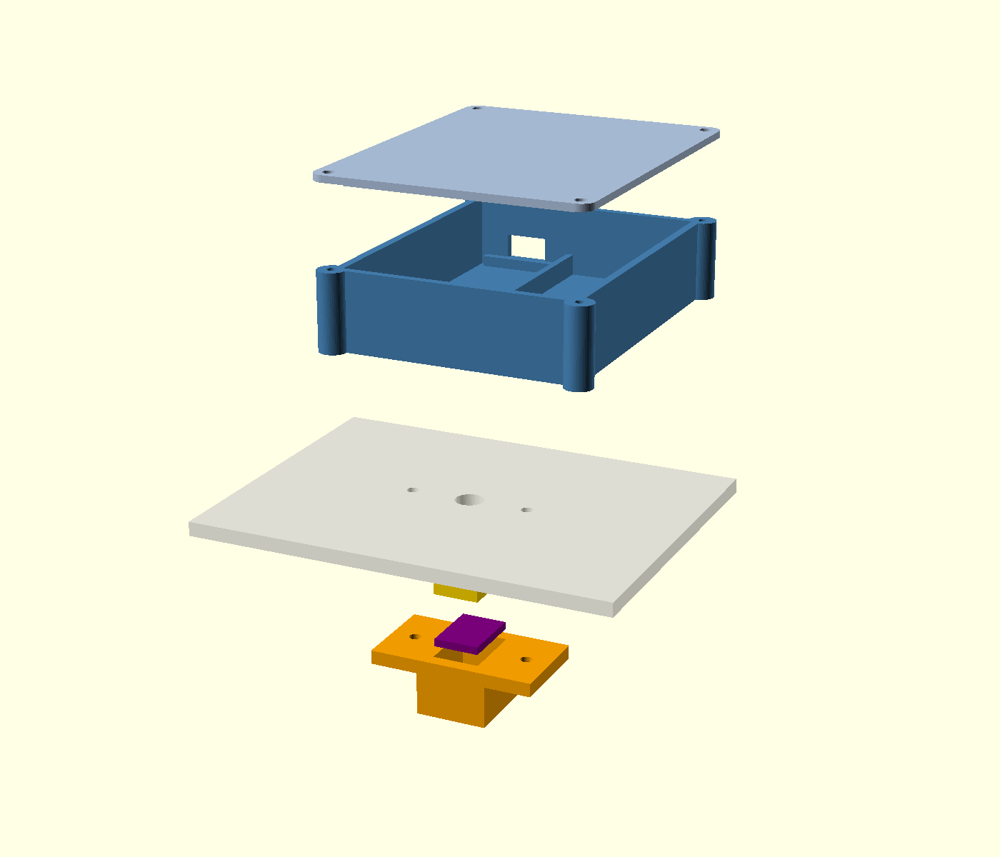
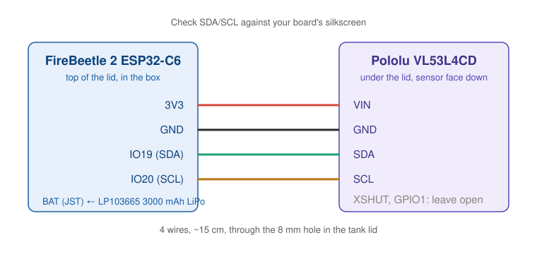

# Pillar

Water softener salt level sensor. A laser time-of-flight sensor hangs under
the brine tank lid and measures the distance down to the salt. An ESP32-C6
on top of the lid wakes every 12 hours, reports to Home Assistant and goes
back to sleep, so it runs for a long time on one LiPo.



| Path | What it is |
| --- | --- |
| `esphome/pillar.yaml` | Firmware (ESPHome, deep sleep) |
| `esphome/components/vl53l4cd/` | VL53L4CD driver (ESPHome has none built in) |
| `esphome/secrets.yaml.example` | Template for the git-ignored `secrets.yaml` |
| `homeassistant/packages/pillar.yaml` | Low salt, low battery and offline alerts, stay-awake switch |
| `hardware/pillar.scad` | All printed parts (OpenSCAD, parameters at the top) |
| `hardware/pillar-*.stl` | Ready-to-print parts |
| `hardware/wiring.svg` | Wiring diagram |

## Parts

| Part | Notes |
| --- | --- |
| DFRobot FireBeetle 2 ESP32-C6 (DFR1075) | Controller, battery charger built in |
| Pololu VL53L4CD carrier (#3692) | Sensor, 1–1200 mm, 18° field of view |
| LP103665 3000 mAh LiPo, JST-PH | **Check polarity against the board before plugging in** |
| 4 wires, ~15 cm, 24–26 AWG | Red, black and two colours |
| 2 × M3 bolts + 2 × M3 nuts, stainless | M3 × 12 for a lid up to ~5 mm thick, M3 × 16 up to ~9 mm |
| 4 × M3 × 8 self-tapping screws | Box lid (or #4 sheet-metal screws) |
| Double-sided foam tape | Holds the FireBeetle on its rails |
| Conformal coating spray + Kapton tape | Salt air protection for the sensor board |
| Clear silicone | Seal the lid hole |

## Wiring



| FireBeetle | Pololu |
| --- | --- |
| 3V3 | VIN |
| GND | GND |
| IO19 | SDA |
| IO20 | SCL |

XSHUT and GPIO1 stay unconnected. The battery plugs into the FireBeetle's JST
connector. **Check SDA/SCL on your board's silkscreen**; if they're on other
pins, change `sda_pin` / `scl_pin` in `esphome/pillar.yaml`.

Solder the wires straight to the Pololu board instead of using the header
pins. The hood is sized for wires coming off the back of the board.

## Printing

PETG, 0.2 mm layers, 4 walls, 30–40 % infill, no supports.

| File | Orientation |
| --- | --- |
| `pillar-hood.stl` | Flange down (the face that touches the tank lid goes on the bed) |
| `pillar-spacer.stl` | Flat |
| `pillar-box.stl` | Open side up |
| `pillar-box_lid.stl` | Flat, lip up |
| `pillar-template.stl` | Flat (drill template for the tank lid) |

To change something, edit the parameters at the top of `hardware/pillar.scad`
and re-export, e.g.
`openscad -o hardware/pillar-hood.stl -D 'part="hood"' hardware/pillar.scad`.

## Build

1. **Flash first, on the bench.** Wire the sensor, then:

   ```sh
   cd esphome
   cp secrets.yaml.example secrets.yaml   # fill it in
   esphome run pillar.yaml                # USB the first time
   ```

   Add Pillar in Home Assistant's ESPHome integration, then copy
   `homeassistant/packages/pillar.yaml` into `<config>/packages/` (see the
   comment at the top of that file) and restart. Turn on **Pillar stay
   awake**, press **Measure Now**, and check that **Salt Distance** matches a
   tape measure to the ceiling or a wall.
2. **Check the battery reading.** Compare **Battery Voltage** with a
   multimeter on the battery. If it's off, adjust `battery_divider`.
3. **Protect the sensor board.** Peel off the clear protective film on the
   sensor chip if it has one. Cover the sensor chip with Kapton tape, spray
   both sides of the board with conformal coating, and take the tape off once
   it's dry. The lens must stay clean.
4. **Drill the tank lid.** Pick a spot over the middle of the salt, away from
   the brine well tube. Tape the template down, punch the three marks, then
   drill 8 mm in the middle and 3.5 mm at each side.
5. **Mount the hood.** Drop the sensor board into the hood face down so it
   sits on the ledge, put the spacer on top of it, and feed the wires up
   through the lid hole. Bolt the box and hood together through the lid: bolt
   heads inside the box, nuts in the pockets on the hood. Run a bead of
   silicone around the wires where they come through the lid.
6. **Finish the box.** Battery in the long bay, FireBeetle in the other on foam
   tape with USB-C at the opening, wires soldered to its pins. Screw on the
   lid.
7. **Calibrate** (below), then turn **Pillar stay awake** off. It measures and
   goes to sleep.

Turn **Pillar stay awake** on whenever you want to flash over Wi-Fi or watch
logs. The device sees it on its next wake (up to 12 h, or press reset) and
stays up until you turn it off.

## Calibration

The salt level is a straight line between two distances in
`esphome/pillar.yaml`:

- `empty_distance_mm`: Salt Distance when the salt is low enough that you'd
  refill (0 %)
- `full_distance_mm`: Salt Distance right after a full fill (100 %)

The easiest way is to note **Salt Distance** just before your next refill
(empty) and again right after (full), put both in the file and reflash.
Until then, the placeholders (800 / 250 mm) give a rough reading.

**Salt Above Empty** is the same reading in inches above the empty mark.

## Battery life

Rough estimate, not measured: the board sleeps at about 16–36 µA (it depends
on the board revision), and each wake is a few seconds of Wi-Fi. At 2 wakes a
day that works out to well over a year per charge on 3000 mAh. **Battery
Voltage** and **Battery** show the real trend after a few weeks. Charge over
USB-C through the opening in the box, no need to unmount anything.

## Notes and assumptions

- **Firmware build:** the VL53L4CD driver is ported from Pololu's Arduino
  library (ST ULD API). It was syntax-checked against ESPHome 2026.11 and the
  config validates, but it hasn't been run on hardware yet. If the first
  build or boot shows an error, the logs from `esphome run` will say which
  part.
- **Battery pin:** IO0 through the board's divider, assumed 1:2. Check it once
  with a multimeter (step 2).
- **Sensor ledge:** the hood assumes the Pololu board has no parts within
  about 1 mm of the edges on the sensor side. If the board rocks on the
  ledge, shave the spot or lower `ledge` in the SCAD file.
- **Range:** the VL53L4CD reads up to about 1.2 m. Most brine tanks are
  shallower, but if yours is deeper, the sensor reports no reading when the
  salt is very low, and Salt Level stops updating.
- **Bridging:** if the salt crusts into a hollow shell, the sensor sees the
  top of the crust. Break it up now and then.
